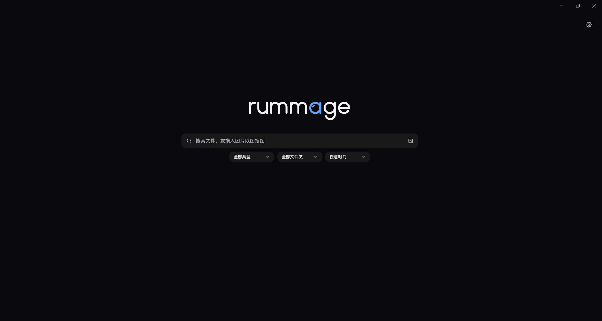
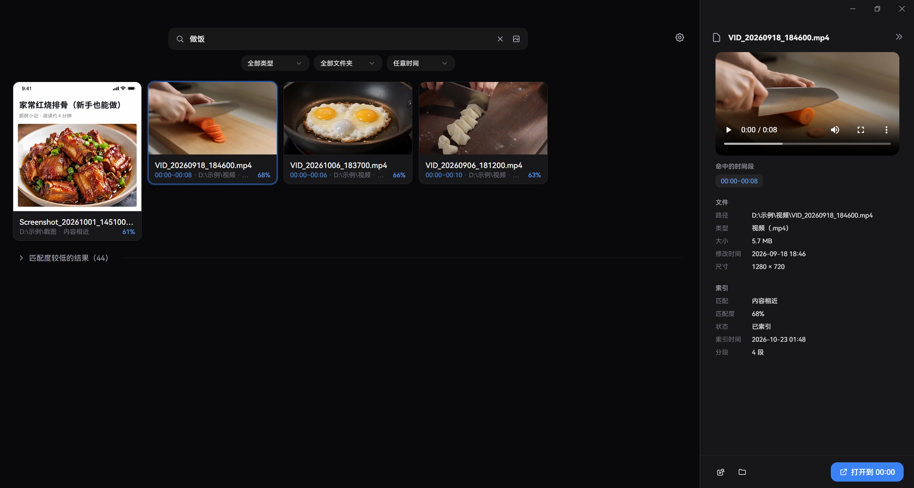
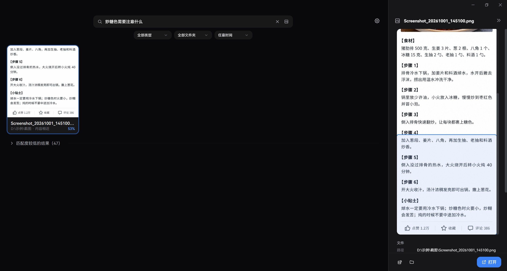
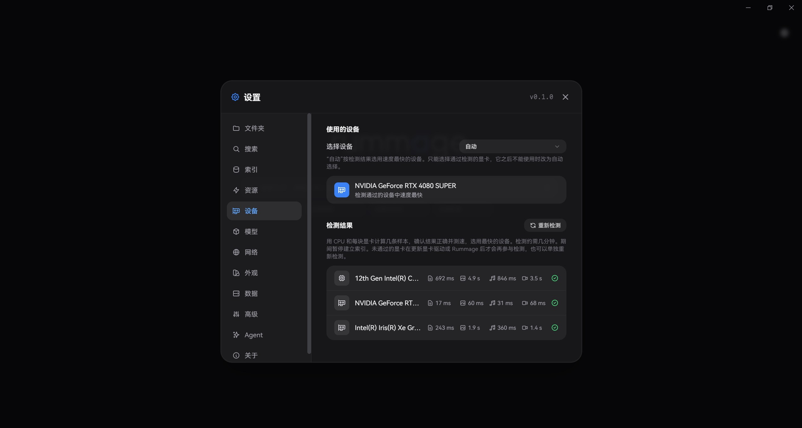
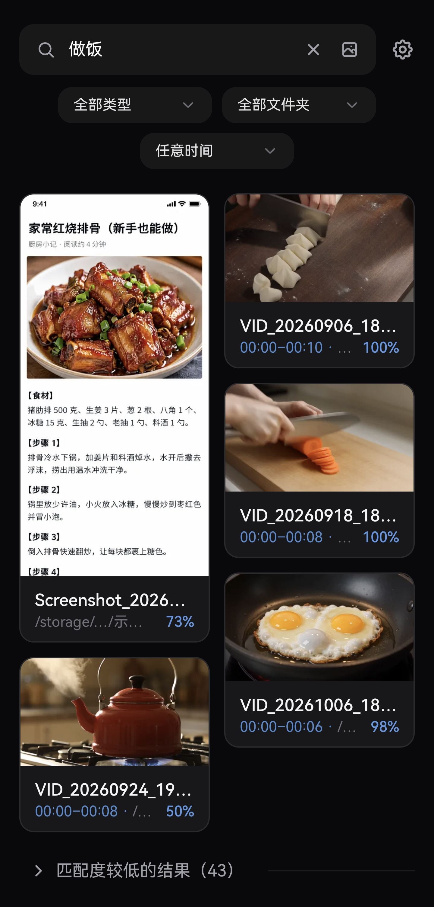
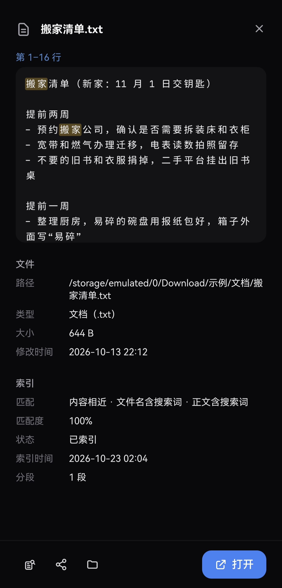

<div align="center">


# Rummage

[](LICENSE)
[](https://github.com/CookSleep/Rummage/releases/latest)
[](#-安装)
[](#-安装)

**本地运行的多模态文件语义搜索器**

你是否曾苦恼于水群找不到梗图，发消息翻不到文件？来试试 Rummage！<br>
用一句话描述文件的内容，在你选定的文件夹中找到文档、照片、截图、录音和视频，也可以以图搜图。<br>
即便是非完全匹配的模糊查询、跨模态的搜索，甚至一个问句，一样能获得高精度的结果！<br>
基于 [Google DeepMind](https://deepmind.google/) 的 [EmbeddingGemma 2](https://gemma.ai/models/embeddinggemma/model-card-v2/)，纯本地推理，数据不离机。

</div>

---

## 📸 界面预览

<details>
<summary><b>点击展开截图展示</b></summary>
<br>

<div align="center">
  <b>简洁的主界面</b><br>
  
</div>

<br>

<div align="center">
  <b>搜“做饭”，找出相关的视频和截图</b><br>
  
</div>

<br>

<div align="center">
  <b>直接提问，长截图定位到回答问题的那一段</b><br>
  
</div>

<br>

<div align="center">
  <b>检测 CPU 与显卡，自动选用最快的设备</b><br>
  
</div>

<br>

<div align="center">
  <b>Android 搜索结果</b><br>
  
</div>

<br>

<div align="center">
  <b>Android 文档详情：显示命中段落</b><br>
  
</div>
</details>

---

## ✨ 功能

### 🔍 按内容搜索
- **一句话描述**：如“键盘的开箱视频”“趴在沙发上哈士奇”，[中英文（以及其他 100 多种语言）都可以](https://gemma.ai/models/embeddinggemma/model-card-v2/)；同时匹配文件名和文档中的原词。
- **以图搜图**：点搜索框右侧的按钮选择图片，电脑上也可以把图片拖进窗口；可以再加一句文字描述，如“同一只狗，在草地上”。
- **找相似**：任意结果都可以作为新的查询，找出同类的图片、文档、音频或视频。
- **筛选**：按文件类型、文件夹、修改时间缩小范围。
- **命中位置**：视频和音频标出命中的时间段，文档标出页码并显示命中的段落，长截图框出命中的部分。
- **匹配度**：每个结果标出匹配度，匹配度较低的结果折叠在列表末尾，不会把真正相关的结果挤下去。

### 📁 支持的文件
- **文档**：PDF、Word、Excel、PowerPoint、OpenDocument、RTF、TXT、Markdown、HTML、XML、CSV、JSON；文档中的图片、音频和视频也会识别。
- **图片**：JPG、PNG、WebP、BMP、TIFF、GIF、HEIC、AVIF（Windows 上 HEIC / AVIF 需要系统已安装对应的图像扩展）。
- **音频**：MP3、M4A / AAC、WAV、FLAC、OGG / Opus、WMA、AMR。
- **视频**：MP4、MOV、MKV、WebM、AVI、WMV、FLV、TS / M2TS、3GP。
- Android 上的音视频以系统能解码的格式为准。其他文件只按文件名索引，同样可以搜到。

### 🖼️ 结果与预览
- **瀑布流**：图片和视频直接显示缩略图，按匹配度排列。
- **详情预览**：图片看大图，视频和音频从命中时刻开始播放，文档显示命中片段及前后段落。
- **打开到 03:12**：电脑上默认播放器或 PDF 阅读器支持时，直接跳到命中的时间或页码（VLC、mpv、PotPlayer、MPC-HC / MPC-BE、SumatraPDF、Adobe Acrobat / Reader、Microsoft Edge）。
- **电脑快捷键**：方向键选择，`Enter` 打开，`Ctrl+Enter` 在资源管理器中显示，空格收起或展开详情。
- **手机找文件**：用其他应用打开、在文件管理器中显示或直接分享。

### ⚙️ 索引与设置
- **只看你选的文件夹**：支持 `.gitignore` 写法的排除规则，文件增删改后自动更新。隐藏文件默认排除；手机上添加文件夹时还会预填排除以 `.` 开头的文件与文件夹（缩略图、应用缓存等），并默认跳过含 `.nomedia` 的文件夹，都可以在排除规则中修改。
- **自动选设备**：电脑上检测 CPU 与各块显卡（Vulkan），手机上检测 CPU、GPU 与 NPU，从通过检测的设备中选用最快的。
- **安静地在后台干活**：电脑上未接电源、全屏时自动暂停，关闭窗口时可留在托盘；手机上在通知栏显示进度，电量低时自动暂停、接上电源后继续，可设为未接电源或亮屏时暂停，温度过高时自动放慢或暂停。也可以随时手动暂停。
- **不碰网盘占位文件**：网盘“按需下载”的占位文件不会被读取，也不会触发下载。
- **参数随你调**：分段长度、图片识别精度、视频识别方式、匹配度门槛等都可以在设置中调整。改了影响索引的参数后，只在后台重建受影响的部分，期间旧索引照常可搜。
- **配置可迁移**：文件夹、排除规则与参数可以导出为配置文件，在同类设备上导入。电脑上数据目录可以改到其他磁盘。

### 🤖 命令行、MCP 与 Skill（Windows）
- **命令行**：`rummage-core` 可以搜索、查看状态、管理文件夹与设置，方便脚本和启动器调用。
- **MCP 与 Skill**：让 Claude Code、Codex、Claude Desktop、Cursor、VS Code、OpenCode 等 AI 工具直接搜索你的文件，并把结果导出为 CSV、JSON 或路径列表。在“设置 → Agent”中可以一键添加 MCP、安装给 AI 用的使用说明（Skill）。

---

## 💻 系统要求

**Windows**
- 64 位 Windows 10 / 11。
- 磁盘：文字模型约 310 MB，图片与音视频模型约 555 MB（选了图片、音频或视频时才需要），另加索引的占用（引导中会预估）。
- 显卡可选：支持 Vulkan 的独立显卡或核显可以明显加快建立索引的速度。

**Android**
- Android 11 及以上，64 位（arm64）手机。
- 存储：模型约 520–650 MB（随芯片而定），另加索引的占用（引导中会预估）。
- 芯片有对应的 NPU 版模型时（部分高通骁龙、联发科天玑与 Google Tensor 芯片）优先用 NPU，速度最快、最省电；其他手机用 GPU 或 CPU。

## 📦 安装

**Windows**

1. 在 [Releases](https://github.com/CookSleep/Rummage/releases/latest) 中下载以 `_x64-setup.exe` 结尾的安装包。
2. 安装包没有代码签名，遇到 SmartScreen 提示时点击“更多信息 → 仍要运行”。
3. 按当前用户安装，不需要管理员权限。默认安装到 `%LOCALAPPDATA%\Rummage`，可以改到普通文件夹（如 `D:\Apps\Rummage`）；不要装到 `C:\Program Files` 等需要管理员权限写入的位置。
4. 安装时默认勾选“添加到 PATH”，之后可以在终端中直接运行 `rummage-core`。

数据默认保存在 `<安装目录>\data` 中，可以在“设置 → 数据”中更改。

**Android**

1. 在 [Releases](https://github.com/CookSleep/Rummage/releases/latest) 中下载以 `_android-arm64.apk` 结尾的安装包，用文件管理器打开安装。系统提示“安装未知应用”时，允许当前的文件管理器或浏览器安装。
2. 首次打开时授予“所有文件访问”权限：Rummage 需要读取你选定文件夹中的文件，它不修改、不删除任何文件。

新版本发布后，两个平台的应用都会提示更新，并可以在应用内下载、安装。

## 🚀 首次使用

打开 Rummage 后按引导完成五步：

1. **选择文件夹**：要搜索的文件夹，至少一个。手机上可以一键添加 DCIM、Pictures、Download、Documents。
2. **文件类型**：希望按内容查找的类型（文档、图片、音频、视频）。选了视频时再选识别方式：找物体、找动作或找说话内容。
3. **下载模型**：从 Hugging Face 下载，下载后校验。国内连接较慢时可以切换到魔搭或设置代理，也可以导入已下载的模型文件。手机上芯片有 NPU 版模型时先下载它（高通芯片另从 Maven Central 下载约 8 MB 的 QNN 运行库）；NPU 不可用时再下载通用模型。
4. **检测设备**：检测各个设备能否正确计算以及速度，自动选择最快的；电脑上也可以只用 CPU。
5. **预估**：根据文件数量与大小预估建立索引的时间和占用空间。

完成后在后台建立索引。建立索引期间就可以搜索，已处理的文件随时能搜到。

> 部分手机系统会在应用退到后台几秒后暂停它，开启电池优化白名单也无法解决。当锁屏或切到其他应用后进度不动时，可在“设置 → 资源”的“后台运行”中按提示打开系统的应用信息页，在“电量”或“电池”中允许 Rummage 在后台运行。

## 🤖 命令行与 MCP

安装时勾选了“添加到 PATH”就可以直接运行 `rummage-core`，否则需要写出安装目录中 `rummage-core.exe` 的完整路径。后台服务没在运行时，命令行会自动启动它。

```
rummage-core search 键盘的开箱视频 --type video --limit 10
rummage-core search 在草地上 --image "D:\照片\柯基.jpg"
rummage-core search 哈士奇 --since 2026-01-01 --folder "D:\照片" --json
rummage-core context <命中 ID>
rummage-core status
rummage-core folders add "D:\资料" --exclude "*.tmp"
rummage-core settings
rummage-core pause --minutes 60
rummage-core failed retry
```

- 不带参数运行 `rummage-core` 查看全部命令与参数。
- `--json` 输出单行 JSON，便于脚本处理。退出码：0 有结果或操作成功，1 没有结果，2 出错。
- 不能通过命令行选择设备、下载或删除模型、清空索引、更改数据目录，请在 Rummage 中操作。

**MCP**：在“设置 → Agent”中一键添加到已安装的 AI 工具，或在 AI 工具中配置运行 `rummage-core mcp`（stdio），例如 Claude Code：

```
claude mcp add --scope user rummage -- rummage-core mcp
```

提供 `search_files`、`get_hit_context`、`index_status` 以及管理文件夹、设置、暂停与失败文件的工具。各客户端的配置方法与 Skill 见安装目录中的 `skills\rummage\`，或仓库的 [`skills/rummage/`](skills/rummage/)。

## 🔒 数据与隐私

- 纯本地推理，文件内容、索引和搜索记录都不会离开你的设备，也不收集任何使用数据。
- 只在下载模型和检查更新时联网。
- Rummage 不修改、不移动、不删除你的文件；所有数据保存在数据目录中（Android 上为应用私有目录），不写入被索引的文件夹。
- 移除文件夹只删除它的索引。电脑上卸载时可选择删除应用数据，被索引的文件夹任何情况下都不会被触碰。

## 🛠️ 从源码构建

需要 Node.js 24、Rust（1.92 以上）和 Tauri 的构建环境，见 [Tauri 前置条件](https://v2.tauri.app/start/prerequisites/)。

**Windows**

```powershell
npm install
powershell -ExecutionPolicy Bypass -File scripts/fetch-llama.ps1
powershell -ExecutionPolicy Bypass -File scripts/fetch-ffmpeg.ps1
npm run tauri:dev
```

打包安装程序还需要：

```powershell
powershell -ExecutionPolicy Bypass -File scripts/fetch-llama.ps1 -Variant vulkan
npm run tauri:build
```

- 获取脚本下载 llama.cpp 预编译运行库与 LGPL 版 ffmpeg，校验钉定的 SHA-256 后放到 `.cache/third-party/`。
- `tauri:build` 需设置 `TAURI_SIGNING_PRIVATE_KEY`（私钥内容或路径）和 `TAURI_SIGNING_PRIVATE_KEY_PASSWORD`，用于给更新包签名。自行分发时用 `npx tauri signer generate` 生成自己的密钥，并替换 `src-tauri/tauri.conf.json` 中的 `plugins.updater.pubkey` 和更新地址。

**Android**

另需 Android SDK 与 NDK，并在 Windows 上开启开发者模式：

```powershell
rustup target add aarch64-linux-android
powershell -ExecutionPolicy Bypass -File scripts/fetch-litert.ps1 -Platform android_arm64
$env:ANDROID_HOME = "D:\Android\Sdk"
$env:NDK_HOME = "D:\Android\Sdk\ndk\<版本>"
$env:CARGO_TARGET_DIR = "D:\rummage-target-android"
npx tauri android build --debug --target aarch64 --apk
```

- `fetch-litert.ps1` 下载 LiteRT-LM 运行库与 NPU 分发库并校验。NDK 的链接器处理不了含中文的路径，`CARGO_TARGET_DIR` 要放在纯英文路径下。
- 开发规范见 [`AGENTS.md`](AGENTS.md)。

## 📄 许可

本项目基于 [MIT License](LICENSE) 开源。

- 模型 [EmbeddingGemma 2](https://huggingface.co/google/embeddinggemma-2) 以 Apache 2.0 许可发布，由用户下载，不随程序分发。高通 NPU 所需的 QNN 运行库为高通的专有许可，只在高通 NPU 手机上按需下载，不随程序分发。
- 随程序分发的 llama.cpp（MIT）、FFmpeg（LGPL v3，以独立程序调用）、LiteRT-LM 与 NPU 分发库（Apache 2.0）、字体与其他依赖的许可见应用的“设置 → 关于 → 第三方许可”（清单原文为 [`src/assets/third-party-notices.txt`](src/assets/third-party-notices.txt)），FFmpeg 的源码获取方式见 [`third-party-licenses/FFmpeg-NOTICE.txt`](third-party-licenses/FFmpeg-NOTICE.txt)。

## 🙏 致谢

Rummage 站在许多优秀项目的肩膀上：

- [DigUp](https://github.com/ARahim3/DigUp)：同样基于 EmbeddingGemma 2 的本地语义文件搜索器，是 Rummage 的重要参考。llama.cpp 的版本选择、音频处理、视频取帧以及 `.ts` 文件的识别都参考了它的做法，评测中也以它为对照。
- [EmbeddingGemma 2](https://gemma.ai/models/embeddinggemma/model-card-v2/)（[Google DeepMind](https://deepmind.google/)）：把文字、图片、音频和视频放进同一个向量空间的多模态嵌入模型，Rummage 的搜索能力源自于它。
- [llama.cpp](https://github.com/ggml-org/llama.cpp)：电脑上的推理引擎，让 CPU 和显卡都能运行模型。
- [Vulkan](https://www.vulkan.org/)（Khronos Group）：跨厂商的图形与计算接口，让 NVIDIA、AMD、Intel 的独显和核显都能运行模型。
- [LiteRT-LM](https://github.com/google-ai-edge/LiteRT-LM)：手机上的推理引擎，让 NPU、GPU 和 CPU 都能运行模型。
- [Xberg](https://github.com/xberg-io/xberg)：从 PDF、Office 等各类文档中提取文字与内嵌媒体。
- [FFmpeg](https://ffmpeg.org/)：电脑上的音视频解码。
- [Tauri](https://tauri.app/)：一套代码同时构建 Windows 与 Android 客户端。
- [SQLite](https://sqlite.org/)：索引与元数据的存储。
- [Hugging Face](https://huggingface.co/) 与 [魔搭 ModelScope](https://modelscope.cn/)：模型的托管与国内下载源。
- [Lobe Icons](https://github.com/lobehub/lobe-icons)：“设置 → Agent”中各个 AI 工具的图标。

以及其他所有依赖的作者，完整清单见“设置 → 关于 → 第三方许可”。

特别致谢：[LINUX DO](https://linux.do)
